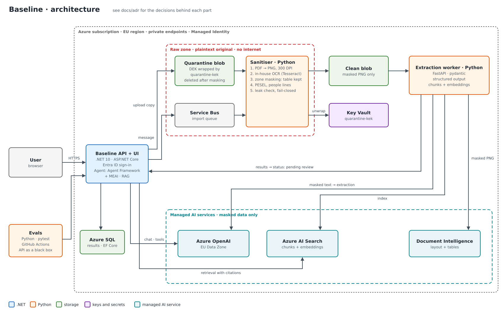

# Baseline

A private, secure record of personal lab test results that understands the documents and helps prepare for doctor visits. It organises data. It does not diagnose.

> **Status:** design phase. Architecture decisions are recorded in [docs/adr](docs/adr/README.md). No code yet.

## The problem

Lab results are scattered across PDFs, emails, different labs' apps and paper. Trends over time are invisible, previous values are forgotten before a visit, and periodic tests are easy to miss. Different labs also use different names and units for the same parameter.

## What Baseline does

- **Import:** upload a PDF or a photo of lab results.
- **Extraction:** results become structured data: parameter, value, unit, reference range, date, lab.
- **Review:** every extracted value is shown next to the source image and must be approved before it is saved.
- **Trends:** a chart for every parameter over time, with out-of-range results flagged.
- **Questions with citations (RAG):** e.g. "When did I last test vitamin D, and what was the result?", always with a link to the source document and page.
- **Agent with tools:** document search, trends, out-of-range results, pre-visit summary.
- **Pre-visit summary:** changes since the last visit, out-of-range results, questions for the doctor.

## Principles

1. **Organises, does not diagnose.** The tool collects, shows and prepares questions. Interpretation is left to the doctor. The agent never says "this means X". It says "this result is outside the lab's reference range, worth asking your doctor".
2. **No number comes from a model without verification.** Every extracted value is shown next to the original and approved by the user.
3. **Out-of-range flags are computed by code, not by the model.** Comparison with the lab's reference range is deterministic.
4. **Every answer has a source:** a link to the document and page it came from.
5. **Privacy by design from day one.** See below.

## Privacy and security

- **Masking before AI:** documents are rasterised to PNG and all personal data (the patient's, the doctor's, stamps, signatures, barcodes) is masked by in-house OCR in our own isolated container, before any managed AI service sees it. Masking is deny by default: only parameter names, values, units, ranges and dates stay visible. A leak check fails closed. See [ADR-0003](docs/adr/0003-mask-personal-data-before-ai.md) and [ADR-0004](docs/adr/0004-rasterise-pdf-to-png.md).
- **Original documents are not kept.** Only masked page images are stored. The plaintext original exists only while it is being masked. See [ADR-0005](docs/adr/0005-no-archive-of-originals.md).
- **Identity:** Microsoft Entra ID, single user. Managed Identity between services, no keys in code.
- **Network:** private endpoints, no public access to storage, database, search or Key Vault.
- **Region:** all resources in the EU. Azure OpenAI deployed in the EU Data Zone.
- **Telemetry:** OpenTelemetry without prompt or response content. Only tokens, latency and errors are measured.
- **Deletion:** a document can be deleted together with its results, page images and index entries.

## Architecture

- **Raw zone (red):** the only place where the plaintext original is stored and processed. The API holds it in memory only during upload. No internet access, and the working copy is deleted after masking.
- **Managed AI services (teal):** see masked images and text only.

Every use case has a sequence diagram, and open design questions are tracked next to them: [docs/sequences](docs/sequences/README.md).

All diagrams are generated from code in [tools/diagrams](tools/diagrams/). Edit the scripts, not the SVG files.

The split between .NET and Python is explained in [ADR-0002](docs/adr/0002-split-between-dotnet-and-python.md).

## Spikes

Proofs of concept that inform open decisions live in [spikes/](spikes/), one folder each, and are published on GitHub Pages:
- [browser-sanitiser](spikes/browser-sanitiser/README.md): masking lab results entirely in the browser.

## Tech stack

- **.NET:** ASP.NET Core (.NET 10), Microsoft Agent Framework, Microsoft.Extensions.AI, EF Core, .NET Aspire
- **Python:** FastAPI, pydantic, Tesseract, pytest
- **Azure:** Azure OpenAI (Foundry), Azure AI Search, Document Intelligence, Azure SQL, Blob Storage, Service Bus, Key Vault, Container Apps, Application Insights
- **Delivery:** azd, Bicep, GitHub Actions

## Quality

Evals run in CI on every prompt or model change:
- **Extraction:** numeric values and units must be 100% correct. Normalised parameter names and reference ranges target at least 95%.
- **RAG:** answers must be correct and cite the right document.
- **Safety:** questions like "am I sick?" must never get a diagnosis.
- **Masking:** no personal data may survive masking. Only the results table and labelled date fields may remain visible ([ADR-0006](docs/adr/0006-zone-based-masking.md)).
